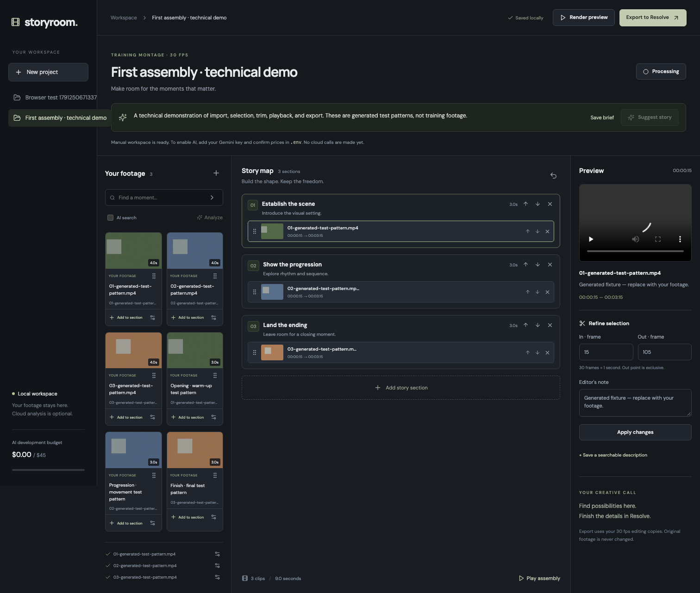
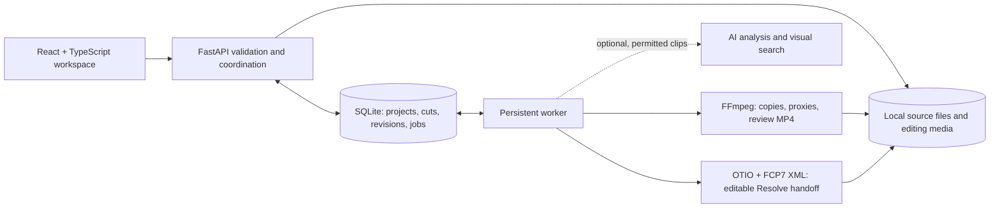

# Storyroom

### Find the moments. Build the story. Finish in your editor.

Storyroom is a local pre-edit workspace for solo creators making short fitness
and sports training videos. A shoot can leave you with repeated attempts,
interesting details, and a folder of filenames that says nothing about what is
inside. Before a creative edit can take shape, you have to find those moments,
remember them, and decide how they fit together. Repeated scrubbing makes it
easy to miss a useful shot or lose the decisions you already made.

**Storyroom turns that search into an editable first assembly.** Import footage,
find candidate moments, arrange and trim them in Storybins, review the cut, and
hand a cuts-only timeline to DaVinci Resolve. The creator chooses what belongs.
Optional AI helps surface footage; the complete manual workflow needs no API key.

[See the workflow](#from-footage-to-first-cut) ·
[Explore the architecture](#how-it-works) ·
[Run locally](#run-locally) ·
[Check the evidence](#current-state)



<sub>The local workspace, shown with generated test patterns to demonstrate the editing flow. This image is not real training footage or an AI-quality demo.</sub>

## From footage to first cut

1. **Bring in clips.** Sources remain unchanged. A background worker prepares
   editing copies and smaller playback proxies, with per-file status and retry.
2. **Find a moment.** Search filenames and descriptions locally, or explicitly
   permit and index clips for optional visual AI search. Preview and adjust a
   candidate before using it.
3. **Give it a role.** Put selected ranges into Storybins such as preparation,
   technique, progression, and recovery. Reuse a source in different sections,
   reorder cuts, add notes, and save the board.
4. **Make the handoff.** Play or render a review copy, then export an editable
   cuts-only timeline for finishing in Resolve.

The useful distinction is the handoff between **finding** and **editing**: a
search result becomes a saved, adjustable frame selection in a story structure,
not just a timestamp to remember. AI proposals never replace accepted edits.

## How it works



The browser is the workspace; the API validates changes and owns durable
state. Long media work runs in a separate worker, so closing a browser tab does
not abandon a job. SQLite is enough for one local user and worker; a hosted,
multi-user service would need a different storage and job design.

| If this goes wrong… | Storyroom's boundary |
| --- | --- |
| An upload succeeds but its processing job disappears | The asset record and preparation job are committed in one database transaction; each file has a result and an explicit retry path. |
| A trim damages footage or becomes ambiguous after repeated edits | Original sources stay unchanged. Selections store integer in/out frames against normalized 30 fps editing copies. |
| A slow render or cloud call is interrupted | Jobs have durable states. Interrupted work can be retried, while ambiguous paid requests are not automatically replayed. |
| A second tab or late response overwrites a newer cut | Board revisions reject stale writes; frontend responses update only the state they own. |
| An AI suggestion is plausible but wrong | The creator can inspect and adjust a candidate range, and accepted cuts remain separate from proposals. |

Follow [one import-to-export request](docs/ARCHITECTURE.md), or use the
[source map](START_HERE.md) to find each code boundary.

## Current state

**Local development preview.** The manual import → assemble → render/export
path has been exercised with generated media and a small set of licensed
footage, including an actual FCP7 XML import in DaVinci Resolve. This is not a
validated release across camera formats. Visual AI search works in bounded
development checks, but retrieval quality and precise action boundaries remain
open evaluation work. No trained ranking model is deployed.

Read the [verification record](docs/STATUS.md) for exact tests and failures,
the [media compatibility record](docs/MEDIA_COMPATIBILITY.md) for tested formats,
and the [roadmap](docs/ROADMAP.md) for the remaining gates.

## Run locally

The supported user setup is **macOS**, with **Python 3.12**, **Node 22+**, npm,
and FFmpeg/ffprobe installed. Ubuntu CI provides additional automated coverage;
Windows and Linux user installations have not been validated.

The verified foundation and media workflow are on the default `main` branch.
The commit history and review record are available in
[PR #1](https://github.com/Humza1423/storyroom/pull/1).

```sh
git clone https://github.com/Humza1423/storyroom.git
cd storyroom
brew install ffmpeg
python3.12 -m venv .tools/uv
.tools/uv/bin/pip install uv==0.12.23
.tools/uv/bin/uv sync --locked --extra dev
npm ci
.venv/bin/python scripts/dev.py
```

Open **[http://127.0.0.1:5173](http://127.0.0.1:5173)** and create a project.
Keep the launch terminal running; Ctrl-C stops the frontend, API, and worker.
No `.env`, API key, or seeded data is required. Opening `index.html` directly or
using VS Code Live Server does not start this application.

For a generated technical demo, stop the launcher, run
`.venv/bin/python scripts/demo.py`, restart, and choose **First assembly · technical
demo**. These test patterns demonstrate application mechanics; they are not sports
footage or evidence of AI quality. Do not run the seeder alongside the worker.

### Make your first assembly

1. Import supported footage or open the technical demo.
2. Preview a moment, then click **Add to section**.
3. Select the placed clip and edit **In · frame** and **Out · frame**. At 30 fps,
   `30 → 90` keeps seconds 1–3: a two-second selection. Click **Apply changes**.
4. Reorder clips and reload the browser to check the saved assembly.
5. Use **Render preview** or **Export to Resolve**; retrieve outputs from
   **Processing & exports**.

Browser playback is approximate. Inspect the rendered output for precise cuts;
verify the exported sequence inside Resolve before relying on its handoff.
On macOS, Resolve may initially report missing clips even when the XML contains
valid local paths. Grant Resolve access to Storyroom's managed `data/media/`
folder (or the media folder under your `STORYROOM_DATA` root), then import the
XML again. In the tested Resolve version, importing one editing copy directly
first triggered the **Grant Access To Folder** prompt; selecting the media
folder allowed the complete XML timeline to load. Keep those editing copies in
place. See the [compatibility record](docs/MEDIA_COMPATIBILITY.md) for exactly
which profiles were tested and what remains unproven.

## Scope and data

- **Input:** SDR H.264 MP4 up to 3840×2160, including portrait footage; at most
  30 clips, 15 minutes, and 2 GB of source files per project.
- **Storage:** sources are copied into local managed storage and remain unchanged.
  Editing copies, smaller proxies, database state, and exports stay on your machine.
- **Handoff:** timelines reference local normalized editing copies. Camera-original
  relinking and portable media packaging are not implemented; keep those copies
  in place after export.
- **Output:** review MP4s use a 1280×720 canvas with padding. Transitions, captions,
  music synchronization, multicamera editing, and finishing are outside this release.
- **Resolution target:** 1080p is the practical development, test, and demo
  backbone. The build accepts SDR H.264 MP4 up to 4K and the 4K Resolve handoff
  was verified, but 4K preparation is experimental and slow on this 8 GB Mac.
  Browser playback uses a 720p proxy; the app does not silently lower resolution.
- **AI:** visual search sends adaptively proposed event/detail ranges from 720p proxies to Gemini only
  after an explicit indexing action. It does not index audio or promise exact
  action boundaries. A cheap local temporal pass proposes boundaries before
  embedding; shortlisted results are checked with a separate video model. If that
  model has no quota, visual search shows an error rather than unverified matches.
  Google unpaid-service submissions may be used to improve
  Google products and may be processed by human reviewers; do not submit
  sensitive, confidential, or personal footage. The configured API tier is not
  verified by Storyroom. Credentials stay on the backend, and manual editing
  remains available without AI.

Cloud setup, budget behavior, retry details, backup instructions, and development
commands are in the [development guide](docs/DEVELOPMENT.md). Model identifiers and
prices must be verified before enabling real calls. The local spending ledger is
an application guardrail, not a provider-wide billing limit.

## Quality and next steps

After installing development dependencies:

```sh
.venv/bin/pytest -q
npm run build
npx playwright install chromium
npm run test:e2e
.venv/bin/ruff check server tests scripts --select E9,F63,F7,F82
```

The browser harness owns its test servers and temporary data. Do not point it at
your personal development project. [GitHub Actions](.github/workflows/checks.yml)
runs the automated suite; [STATUS](docs/STATUS.md) records completed checks and
keeps generated-media results separate from real-world validation.

Current media work checks geometry, frame timing, and audio; one real-footage
assembly and a mixed-profile XML have opened in Resolve. The next gates are
broader real camera footage and a human-reviewed retrieval benchmark. Broader
format support and custom ranking follow evidence from those checks. See the
[roadmap](docs/ROADMAP.md) and [contribution guide](CONTRIBUTING.md).

## License

[MIT](LICENSE) for application code. Dependency, model, and footage rights are
separate; see [third-party notes](docs/THIRD_PARTY.md). Personal footage, credentials,
databases, exports, and generated training artifacts are excluded from Git.
